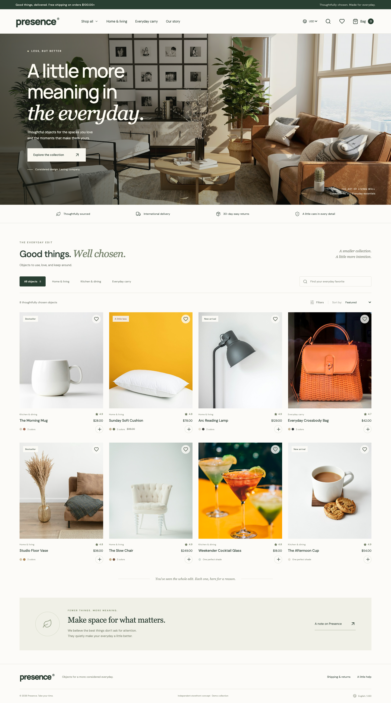

# Presence — Everyday Living

基于 React 19、TypeScript、Vite 从空项目编写的海外消费者商品选购应用。未使用商城模板或现成项目。英文界面、响应式布局、模拟商品数据，无后端与真实支付。

## 启动

使用 Node.js 22.18+ 和 npm，推荐 Node.js 24 LTS。

```bash
npm ci --registry=https://registry.npmjs.org
npm run dev
```

打开终端显示的本地地址，默认 http://127.0.0.1:5173 。无需密钥、环境变量或账号。

```bash
npm run build     # TypeScript 检查并生成 dist/
npm run preview   # 预览生产构建
npm test          # 购物车核心逻辑测试
```

如果本机默认 npm 源是无法访问的内网地址，安装时使用上面的官方源参数即可，不需要修改全局配置。

## 已完成功能

- 8 款模拟商品、3 个品类，商品图片和字体均随源码提供。
- 商品搜索、分类、价格与评分排序、价格筛选、空结果恢复。
- 商品详情、颜色选择、数量调整、库存上限校验。
- 快速加购、购物车增减与删除、多颜色合并规则、金额及运费计算。
- 满 USD 100 包邮，否则运费 USD 8；空购物车不计算运费。
- 收藏及收藏筛选；购物车、收藏、币种使用 localStorage 保存。
- USD / EUR / GBP 显示切换，使用明确标注的固定演示汇率。
- 桌面四列 / 手机两列商品布局、手机导航、购物车抽屉。
- 演示结算：核对商品 → 明确提示无需支付 → 完成演示订单并清空购物车。
- 键盘操作、原生 dialog 焦点约束、Escape 关闭、状态播报、减少动态效果偏好。
- 存储损坏时恢复为空购物车；存储禁用时提示仅本次访问有效。

## 浏览器验证

浏览器测试需先运行开发服务器，再在另一个终端运行：

```bash
npx playwright install chromium
npm run test:e2e
```

如果已安装 Google Chrome，也可以跳过下载浏览器：

```bash
BROWSER_CHANNEL=chrome npm run test:e2e
```

通过 `BASE_URL` 指定测试地址，`QA_OUTPUT_DIR` 指定截图与 JSON 报告目录，默认 `work/browser/`。测试覆盖查找、筛选、收藏、详情、购物车数量、刷新恢复、包邮、结算、手机导航、资源加载、脚本异常以及 360 / 390 / 768 / 1440 px 下的横向溢出。

## 项目结构

```text
src/
  App.tsx                 页面与交互状态
  data.ts                 类型化商品数据
  store.ts                购物车校验、金额和币种逻辑
  components/Modal.tsx    原生对话框与抽屉
  styles.css              响应式样式
  fonts.css               本地字体声明
public/
  images/                 本地商品与场景图片
  fonts/                  本地字体与许可证
tests/
  cart.test.mjs           核心业务测试
  browser.mjs             实际浏览器端到端验证
```

## 部署

这是静态站点，可以部署到 Cloudflare Pages、Vercel、Netlify 或任何静态托管平台。

- 安装命令：`npm ci --registry=https://registry.npmjs.org`
- 构建命令：`npm run build`
- 产物目录：`dist`
- 不需要运行后端服务，不使用服务端路由。

公开仓库未包含本地站点身份和部署配置，可以按上述通用静态托管配置部署。

## 取舍与边界

优先保证「找到商品 → 查看详情 → 加购 → 调整购物车 → 订单核对」闭环，因此未实现登录、后端、支付、地址收集和真实订单。完成演示订单不会发货。

商品价格、库存、评分、材质及配送政策均为模拟数据。币种使用固定汇率 USD 1 = EUR 0.92 = GBP 0.79，非实时汇率；税费和关税不计算。颜色选项用于演示 SKU 选择，共用商品照片，未提供各颜色独立图片。库存仅在当前浏览器校验，不是全站实时库存；跨设备和多标签页状态同步未实现。浏览器测试使用 Chrome，不代表已经完成 Safari / Firefox 或真实手机硬件兼容性测试。

## 素材与开发方式

图片使用 Unsplash 摄影，仅作为概念商品的视觉示意；来源见 [ASSETS.md](./ASSETS.md)。字体为 DM Sans 与 Manrope，许可证随文件保留。图标来自 Lucide。

使用 AI Agent 辅助需求拆解、代码实现、测试与交付整理；录屏来自本应用在浏览器内的真实交互操作，不是界面动画稿。交付前应自行阅读代码并熟悉关键取舍，便于面试交流。

## 交付材料

- [交付说明](docs/交付说明.md)
- [桌面演示录屏，约 73 秒](docs/desktop-demo.webm)
- [手机演示录屏，约 65 秒](docs/mobile-demo.webm)
- [浏览器验证报告](docs/browser-validation.json)
- [桌面截图](docs/desktop-preview.png) · [手机截图](docs/mobile-preview.png) · [手机购物车](docs/mobile-bag.png)


